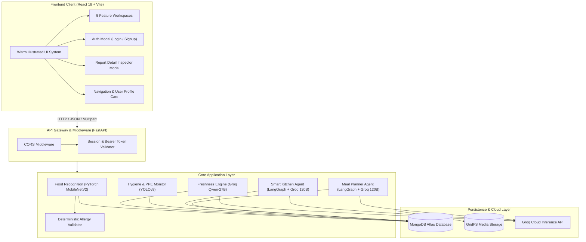

# 🍽️ FoodVerse AI — Next-Gen Multimodal Food Intelligence Platform

<p align="center">
  
</p>

<p align="center">
  <strong>An end-to-end, privacy-conscious AI platform unifying Computer Vision, Large Multimodal Models (LMMs), Agentic Workflows, and Food Safety Intelligence.</strong>
</p>

<p align="center">
  <a href="#-the-5-core-ai-engines"></a>
  <a href="#-technology-stack"></a>
  <a href="#-technology-stack"></a>
  <a href="#-technology-stack"></a>
  <a href="#-technology-stack"></a>
  <a href="#-technology-stack"></a>
  <a href="#-test-suite--quality-assurance"></a>
</p>

---

## 📖 Table of Contents
- [✨ Key Highlights](#-key-highlights)
- [🧠 The 5 Core AI Engines](#-the-5-core-ai-engines)
- [🔐 User Authentication & Personal Profiles](#-user-authentication--personal-profiles)
- [📊 Interactive Live History & Inspection](#-interactive-live-history--inspection)
- [🏗️ High-Level System Architecture](#-high-level-system-architecture)
- [📁 Repository Structure](#-repository-structure)
- [🛠️ Technology Stack](#-technology-stack)
- [🚀 Quickstart & Installation](#-quickstart--installation)
  - [1. Prerequisites](#1-prerequisites)
  - [2. Environment Setup](#2-environment-setup)
  - [3. Running Backend Locally](#3-running-backend-locally)
  - [4. Running Frontend Locally](#4-running-frontend-locally)
  - [5. Running with Docker Compose](#5-running-with-docker-compose)
- [🧪 Test Suite & Quality Assurance](#-test-suite--quality-assurance)
- [📡 API Reference](#-api-reference)
- [🐙 Pushing to GitHub (Step-by-Step)](#-pushing-to-github-step-by-step)
- [📜 License](#-license)

---

## ✨ Key Highlights

- **Multimodal Intelligence at Scale**: Combines edge-fast PyTorch deep neural networks and YOLOv8 object detection with ultra-fast cloud LMM reasoning via Groq (`openai/gpt-oss-120b` and `qwen/qwen3.8-27b`).
- **Zero-Trust Allergen Safety Guard**: Deterministic allergy verification layer that intercepts model outputs and enforces rigid safety overrides for peanuts, shellfish, gluten, dairy, tree nuts, and soy.
- **Enterprise Persistence**: Robust MongoDB Atlas integration utilizing PyMongo Async API, compound indexing, GridFS media chunk storage, and atomic session aggregation.
- **Security-First Architecture**: PBKDF2-HMAC-SHA256 password cryptography (100,000 rounds) paired with HMAC-SHA256 signed bearer tokens with automatic session migration.
- **Warm Illustrated Aesthetics**: Carefully crafted, responsive UI with bespoke earth-toned palettes, micro-animations, glassmorphic accents, and live report inspection.

---

## 🧠 The 5 Core AI Engines

```
                               ┌─────────────────────────────────────────────────────────────┐
                               │                    FoodVerse AI Engines                     │
                               └──────────────────────────────┬──────────────────────────────┘
                                                              │
         ┌─────────────────────────┬──────────────────────────┼──────────────────────────┬─────────────────────────┐
         ▼                         ▼                          ▼                          ▼                         ▼
 🥑 Food Recognition       🌿 Freshness Analysis      🧼 Hygiene & PPE           🍳 Smart Kitchen           🥗 Meal Planner
  • PyTorch MobileNetV2     • Groq Vision (Qwen-27B)   • YOLOv8 PPE Detector      • LangGraph Agent Workflow • LangGraph Planner
  • Food-101 Classifier     • Visual Decay Scoring     • Glove/Mask/Hairnet Check • Groq GPT-OSS-120B        • Macro-Balanced Slots
  • USDA Macro Reference    • Storage Duration Bounds  • Sanitation Audit Report  • Ingredient Scaler        • Weekly Coach Overview
  • Deterministic Allergies • Safety Policy Overrides  • Station Risk Rating      • Step-by-Step Cooking     • Calorie Goal Alignment
```

### 1. 🥑 Food Recognition & Nutrition Intelligence
- **Vision Pipeline**: PyTorch MobileNetV2 fine-tuned on the Food-101 dataset to identify dishes from camera captures or gallery uploads.
- **Deterministic Portions**: Scaled against authentic USDA FoodData Central nutritional references for protein, carbohydrates, fats, dietary fiber, and micronutrients.
- **Deterministic Allergy Safety**: Validates recognized ingredients against zero-trust allergy rules, rejecting hallucinated safety clearances.

### 2. 🌿 Multimodal Freshness & Spoilage Inspection
- **Multimodal Vision**: Powered by Groq `qwen/qwen3.8-27b` to inspect produce and perishables for discoloration, mold, wilting, and textural decay.
- **Temporal Cross-Verification**: Correlates visual observations against user-specified storage conditions and duration.
- **Safety Overrides**: If storage days exceed microbiological safety thresholds, the system deterministically forces safety downgrade warnings regardless of superficial visual appeal.

### 3. 🧼 Kitchen Hygiene & Safety Monitor
- **Real-Time PPE Detection**: Uses Ultralytics YOLOv8n-PPE with verified classification heads for `glove`, `no_glove`, `mask`, `no_mask`, `helmet/hairnet`, and `no_helmet`.
- **Dual-Model Person Verification**: Cross-references scenes with baseline YOLOv8 person detectors. If no personnel are in frame, the system outputs an un-faked `NOT ASSESSABLE` status instead of misleading perfect scores.
- **Audit Analytics**: Generates actionable sanitation risk ratings and compliance scorecards.

### 4. 🍳 Smart Kitchen (AI Recipe Generator)
- **Agentic Workflow**: Multi-step LangGraph workflow utilizing Groq `openai/gpt-oss-120b`.
- **Pantry Flexibility**: Generates creative, Michelin-caliber recipes based on whatever raw ingredients are detected in your kitchen or typed into the prompt.
- **Full Culinary Breakdown**: Returns difficulty level, preparation time, cooking time, comprehensive ingredient tables with units, and numbered chef instructions.

### 5. 🥗 Personalized Meal Planner
- **Target-Driven Nutrition**: LangGraph planner generating balanced 4-meal daily schedules (Breakfast, Lunch, Dinner, Snack) tailored to age, gender, height, weight, activity level, dietary style, and caloric target.
- **Structured Macro Targets**: Validates target calories against Harris-Benedict / Mifflin-St Jeor formulas.
- **Nutritional Coaching**: Produces holistic weekly outlooks, hydration reminders, and meal prep tips.

---

## 🔐 User Authentication & Personal Profiles

FoodVerse AI provides a full-featured identity layer:

- **Sign Up & Account Creation**: Captures **Full Name**, **Birthday** (`YYYY-MM-DD`), **Email ID**, and **Password**.
- **Cryptographic Hashing**: Salted PBKDF2-HMAC-SHA256 (100,000 iterations, 16-byte random salt) protecting all stored credentials.
- **Signed Session Tokens**: Stateless HMAC-SHA256 signed bearer tokens with 30-day lifecycle (`Authorization: Bearer <token>`).
- **Interactive Profile Dashboard**:
  - Displays user avatar, name, email, birthday, MongoDB account ID, and member registration date.
  - Computes and displays **Lifetime Personal Statistics** across all 5 AI engines.
- **Guest Session Auto-Claiming**: Any analyses run before logging in are automatically claimed and bound to your account upon signing in or creating an account.

---

## 📊 Interactive Live History & Inspection

- **Live Dynamic Feed**: Every feature page features a live **Recent Checks** bar that fetches real reports from MongoDB Atlas via `/api/v1/history?feature={name}&limit=3`.
- **Automatic Sync**: Submitting a scan or generating a plan immediately updates the live recent cards.
- **Full-Screen Report Detail Inspector**: Clicking any recent card launches the `ReportDetailModal`, displaying:
  - Nutritional macro breakdowns and identified ingredients.
  - High-resolution visual degradation explanations and safety advisories.
  - Kitchen PPE compliance checklists.
  - Complete recipe instructions and daily meal plans.

---

## 🏗️ High-Level System Architecture



---

## 📁 Repository Structure

```text
Main/
├── .env.example                     # Environment template (ports, keys, URIs)
├── .gitignore                       # Production gitignore (secrets, caches, builds)
├── docker-compose.yml               # Multi-container orchestration
├── README.md                        # Primary platform documentation
│
├── backend/
│   ├── Dockerfile                   # Python 3.12 container specification
│   ├── requirements.txt             # Locked Python dependencies
│   ├── app/
│   │   ├── main.py                  # FastAPI application entry point
│   │   ├── api/
│   │   │   └── routes/              # Modular REST routers
│   │   │       ├── auth.py          # /api/v1/auth (signup, login, me, logout)
│   │   │       ├── food_analysis.py # /api/v1/food-analysis
│   │   │       ├── freshness.py     # /api/v1/freshness-analysis
│   │   │       ├── hygiene.py       # /api/v1/hygiene-analysis
│   │   │       ├── recipes.py       # /api/v1/recipes/generate
│   │   │       ├── meal_planner.py  # /api/v1/meal-plans/generate
│   │   │       ├── history.py       # /api/v1/history & /api/v1/history/summary
│   │   │       ├── media.py         # /api/v1/media GridFS streaming
│   │   │       └── system.py        # /health probe
│   │   ├── core/                    # Security, providers, config
│   │   │   ├── config.py            # Environment loading & path resolution
│   │   │   ├── groq_provider.py     # Multimodal & LLM client (with fallback)
│   │   │   ├── security.py          # PBKDF2 hashing & HMAC token signing
│   │   │   └── session.py           # Session scoping & owner resolution
│   │   ├── db/                      # Persistence repositories
│   │   │   ├── mongodb.py           # Async Motor/PyMongo client & indices
│   │   │   ├── user_repository.py   # User accounts & activity statistics
│   │   │   ├── report_repository.py # Analysis reports persistence & aggregations
│   │   │   └── media_repository.py  # GridFS binary chunk storage
│   │   ├── agents/                  # LangGraph multi-agent workflows
│   │   │   ├── recipe_graph.py      # Stateful Smart Kitchen workflow
│   │   │   └── meal_planner_graph.py# Stateful Meal Planner workflow
│   │   ├── services/                # Computer vision & domain services
│   │   │   ├── food_recognition.py  # MobileNetV2 PyTorch adapter
│   │   │   ├── freshness_service.py # Freshness analysis orchestrator
│   │   │   ├── hygiene_detector.py  # YOLOv8 PPE & personnel detector
│   │   │   ├── allergy_validator.py # Zero-trust allergy rules engine
│   │   │   ├── nutrition_estimation.py# Portion arithmetic
│   │   │   └── image_processing.py  # OpenCV decoding & normalization
│   │   ├── repositories/            # Reference data repositories
│   │   │   └── nutrition_repository.py# USDA FoodData Central query interface
│   │   └── schemas/                 # Strongly typed Pydantic models
│   ├── data/
│   │   ├── food101_classes.json     # Food-101 101 class labels
│   │   └── nutrition_reference.json # USDA 101 reference foods
│   ├── models/
│   │   ├── food101_mobilenetv2.pth  # PyTorch model weights (Food-101)
│   │   ├── yolov8n.pt               # YOLOv8 Base Person detector
│   │   └── yolov8n_ppe.pt           # YOLOv8 PPE detector
│   └── tests/                       # Complete Pytest test suite (76 tests)
│
├── frontend/
│   ├── Dockerfile                   # Node/Vite build container
│   ├── package.json                 # Dependencies and scripts
│   ├── vite.config.js               # Dev server & reverse proxy config
│   ├── index.html                   # HTML entry point
│   ├── public/                      # Static assets & sample media
│   └── src/
│       ├── main.jsx                 # React DOM mount
│       ├── App.jsx                  # Main view state, router, and modal coordinator
│       ├── index.css                # Approved warm illustrated design system
│       ├── features/
│       │   ├── overview/            # Dashboard summary & quick actions
│       │   ├── food-analysis/       # Food Recognition workspace
│       │   ├── freshness/           # Freshness inspection workspace
│       │   ├── hygiene/             # Kitchen safety & PPE monitor
│       │   ├── smart-kitchen/       # AI Recipe generator
│       │   ├── meal-planner/        # Personalized Meal planning workspace
│       │   └── history/             # Historical audit log browser
│       └── shared/
│           ├── api/client.js        # Centralized HTTP client & auth interceptor
│           ├── api/authApi.js       # Auth endpoint methods
│           └── components/
│               ├── Sidebar.jsx      # Navigation sidebar with user status
│               ├── AuthModal.jsx    # Login & registration modal
│               ├── ProfileModal.jsx # User profile & statistics modal
│               ├── RecentChecksSection.jsx # Live recent reports bar
│               └── ReportDetailModal.jsx   # Full report detail inspector
│
└── scripts/                         # Training & evaluation scripts
    ├── train_model.py               # Fine-tune Food-101 MobileNetV2
    ├── evaluate_model.py            # Model benchmark evaluator
    └── init_pretrained_weights.py   # Model weight bootstrap script
```

---

## 🛠️ Technology Stack

| Layer | Technology | Version | Purpose |
| :--- | :--- | :--- | :--- |
| **Backend Framework** | **FastAPI** | `0.115.6` | Asynchronous high-performance REST API |
| **ASGI Web Server** | **Uvicorn** | `0.34.0` | Production ASGI web server |
| **Deep Learning** | **PyTorch / Torchvision** | `2.5.1` | MobileNetV2 Food-101 visual classifier |
| **Object Detection** | **Ultralytics YOLOv8** | `8.3.51` | Real-time PPE and person detection |
| **Computer Vision** | **OpenCV & Pillow** | `4.10.0` / `11.0.0` | Image processing, resizing, normalization |
| **LLM & Multimodal AI** | **Groq Cloud API** | LMM SDK | `openai/gpt-oss-120b` & `qwen/qwen3.8-27b` |
| **Agent Orchestration** | **LangGraph / LangChain**| `0.2.60` | Stateful multi-agent graph workflows |
| **Database** | **MongoDB Atlas / PyMongo**| `4.10.1` | Async document persistence & aggregation |
| **Binary Storage** | **GridFS** | Native | Chunked media storage for images & videos |
| **Frontend Framework** | **React** | `18.3.1` | Interactive component-driven user interface |
| **Build Tool** | **Vite** | `6.0.5` | Fast HMR dev server & production bundler |
| **Styling** | **Vanilla CSS** | Standard | Custom design system (warm cream, deep forest) |

---

## 🚀 Quickstart & Installation

### 1. Prerequisites
- **Python**: `3.10+` (Python `3.12` recommended)
- **Node.js**: `18.0+` & `npm`
- **MongoDB**: MongoDB Atlas Cluster connection URI or local MongoDB (`mongodb://localhost:27017`)
- **Groq API Key**: Obtain a key from [Groq Console](https://console.groq.com/)

---

### 2. Environment Setup

Copy `.env.example` in `Main/` to create `.env`:

```powershell
cd "Main"
copy .env.example .env
```

Open `Main/.env` and configure your credentials:

```ini
# Groq Cloud Multimodal & LLM Provider
GROQ_API_KEY=gsk_YourActualGroqKeyHere
GROQ_TEXT_MODEL=openai/gpt-oss-120b
GROQ_VISION_MODEL=qwen/qwen3.8-27b

# MongoDB Atlas Persistence
MONGODB_URI=mongodb+srv://<username>:<password>@cluster0.gkn97zm.mongodb.net/?retryWrites=true&w=majority
MONGODB_DATABASE=foodverse_ai

# Session Security
SESSION_SECRET=your-random-secure-secret-key-min-32-chars
```

---

### 3. Running Backend Locally

From the `Main/backend` folder:

```powershell
cd "Main\backend"

# 1. Activate virtual environment (or create with: python -m venv venv)
.\venv\Scripts\activate

# 2. Install dependencies
pip install -r requirements.txt

# 3. Start the FastAPI server
uvicorn app.main:app --host 0.0.0.0 --port 8000 --reload
```

- **Health Probe**: `http://localhost:8000/health`
- **Interactive Swagger Docs**: `http://localhost:8000/docs`
- **ReDoc Specification**: `http://localhost:8000/redoc`

---

### 4. Running Frontend Locally

From the `Main/frontend` folder in a new terminal:

```powershell
cd "Main\frontend"

# 1. Install packages
npm install

# 2. Launch Vite development server
npm run dev
```

- **Web Application**: `http://localhost:5173`

---

### 5. Running with Docker Compose

To launch the full stack in synchronized Docker containers:

```powershell
cd "Main"
docker-compose up --build
```

---

## 🧪 Test Suite & Quality Assurance

FoodVerse AI includes a comprehensive test suite with **100% pass rate (76/76 passing)** covering units, integration, error envelopes, and neural inference:

```powershell
cd "Main\backend"
.\venv\Scripts\activate
pytest -v
```

### Test Coverage Highlights:
- **`test_auth.py`**: User registration, duplicate email handling, PBKDF2 authentication, profile inspection, and signed bearer token validation.
- **`test_food_analysis.py`**: Image boundary verification, corrupt uploads, aspect ratio checks, USDA portion scaling, and allergy triggers.
- **`test_freshness.py`**: Visual decay analysis, storage duration safety overrides, and offline envelopes.
- **`test_hygiene.py`**: YOLO PPE detection, person presence checking, and `NOT ASSESSABLE` empty scene tests.
- **`test_smart_kitchen.py`**: LangGraph recipe workflows and JSON schema contract validation.
- **`test_meal_planner.py`**: Daily macro calculations and multi-day meal schedule outputs.
- **`test_mongodb_persistence.py`**: PyMongo async CRUD, compound index integrity, and aggregation pipelines.
- **`test_groq_integration.py`**: LMM multimodal resilience, timeout handling, and retry logic.

---

## 📡 API Reference

| Method | Endpoint | Description | Auth Required |
| :--- | :--- | :--- | :--- |
| `POST` | `/api/v1/auth/signup` | Register new account (Name, Email, Birthday, Password) | No |
| `POST` | `/api/v1/auth/login` | Authenticate user & issue signed bearer token | No |
| `GET` | `/api/v1/auth/me` | Retrieve profile information & lifetime analysis statistics | Bearer Token |
| `POST` | `/api/v1/food-analysis` | Recognize dish via MobileNetV2 & compute USDA macros | Optional |
| `POST` | `/api/v1/freshness-analysis` | Inspect produce freshness & storage safety via Groq Vision | Optional |
| `POST` | `/api/v1/hygiene-analysis` | Audit kitchen station PPE compliance via YOLOv8 | Optional |
| `POST` | `/api/v1/recipes/generate` | Generate tailored culinary recipes via LangGraph Agent | Optional |
| `POST` | `/api/v1/meal-plans/generate` | Generate target-calibrated daily meal plans via LangGraph | Optional |
| `GET` | `/api/v1/history` | Query user's paginated analysis report history | Session / Token |
| `GET` | `/api/v1/history/summary` | Aggregate dashboard report counts & recent activity | Session / Token |
| `GET` | `/api/v1/media/{media_id}` | Stream stored media assets from GridFS bucket | No |
| `GET` | `/health` | Live diagnostic probe for models, DB, and Groq status | No |

---

## 🐙 Pushing to GitHub (Step-by-Step)

Follow these steps to push the `Main` directory to a new GitHub repository:

### Step 1: Create a Repository on GitHub
1. Log in to [GitHub](https://github.com).
2. Click the **`+`** icon in the upper-right corner and select **"New repository"**.
3. Name your repository (e.g., `foodverse-ai`).
4. Keep it **Public** or **Private** according to your preference.
5. **DO NOT** check "Add a README file", "Add .gitignore", or "Choose a license" (we already have complete files prepared).
6. Click **"Create repository"**.
7. Copy the repository URL (e.g., `https://github.com/<your-username>/foodverse-ai.git`).

---

### Step 2: Open Terminal inside `Main`

Open PowerShell or Command Prompt and navigate to `Main`:

```powershell
cd "c:\Users\Lenovo\Desktop\Food AI\Main"
```

---

### Step 3: Stage and Commit the Files

Run the following commands:

```powershell
# 1. Stage all files (our .gitignore automatically keeps .env and secret files excluded)
git add -A

# 2. Check the staged files to ensure .env is NOT listed:
git status

# 3. Create your initial commit
git commit -m "feat: complete FoodVerse AI platform with 5 engines, auth, and MongoDB persistence"
```

---

### Step 4: Link to GitHub and Push

Replace `<your-repository-url>` with your copied GitHub URL:

```powershell
# 1. Rename branch to main
git branch -M main

# 2. Add your GitHub remote
git remote add origin <your-repository-url>

# Example:
# git remote add origin https://github.com/your-username/foodverse-ai.git

# 3. Push to GitHub
git push -u origin main
```

> [!NOTE]
> If GitHub asks for authentication, log in using your browser or a [Personal Access Token (classic)](https://github.com/settings/tokens) with `repo` permissions.

---

## 📜 License

This project is licensed under the **MIT License** — feel free to use and adapt it for research, development, and commercial kitchen intelligence applications.
